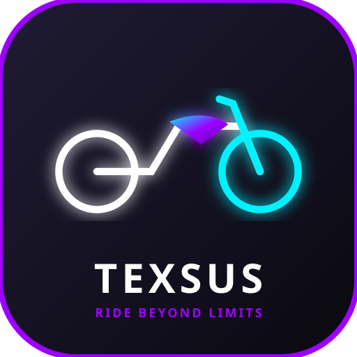

# TEXSUS — Premium 3D Bike Taxi Progressive Web Application
**Ride Beyond Limits.**



---

## 1. Project Overview & Architectural Summary
**TEXSUS** is a frontend-only, installable Progressive Web Application (PWA) simulating a commercial bike taxi booking platform for India (demo operations across Kalol, Gandhinagar, and Ahmedabad with all-India scope, INR ₹ currency, and English / Hindi / Gujarati localization).

The platform features an advanced 3D visual design system using CSS 3D transforms (`perspective`, `preserve-3d`, dynamic mouse tilt), neon purple glow lighting (`#9d00ff`), glassmorphism, GSAP animations, custom SVG charts, and procedural Web Audio synthesizers (muted by default).

### Strict Technology Compliance (Section 2 & 3)
- **Included:** Pure HTML5, CSS3, Vanilla JavaScript (ES modules), GSAP animations, CSS 3D transforms, Custom SVG/CSS charts, Lucide SVG icons, LocalStorage persistent state engine, Service Worker and Web App Manifest.
- **Strictly Disallowed & Excluded:** No React, Next.js, Vue, Angular, TypeScript, Tailwind CSS, Three.js, Framer Motion, backend servers, databases, or real payment/auth APIs.
- **100% Frontend Simulation:** Operates completely inside the browser using a reactive LocalStorage database with persistent demo data.

---

## 2. Demo Credentials Directory (One-Click Access)
All four roles have instant **One-Click Demo Access** and simulated login dialogs on the home screen:

| Role | Demo Identity | Credentials | Key Features |
|---|---|---|---|
| **Customer** | Aarav Patel | Phone: `+91 98250 11001`<br>Demo OTP: `4021` (or Google Sign-In) | 14 screens, 12-step booking, 5 bike categories, manual driver select, live 3D tracking, 3s SOS defense |
| **Driver (Captain)** | Vikram Thakor | Phone: `+91 97240 22001`<br>Demo OTP: `4021` | Online/offline toggle, 30s request acceptance timer, turn-by-turn navigation, KYC document resubmission |
| **Admin** | Kavita Iyer | Email: `admin@texsus.com`<br>Pass: `admin123` | 10 screens: driver KYC approval/rejection, dynamic pricing, waiting fees, ₹20 commission, coupons, audit logs |
| **Owner** | Vikramaditya Singhania | Email: `owner@texsus.com`<br>Pass: `owner123` | Executive C-suite: custom SVG financial charts, platform GMV, admin user management, revenue exports |

---

## 3. Core Feature Systems

### A. Customer Application & 12-Step Booking Workflow (Sections 7 & 8)
- **14 Customer Screens:** Home, Booking, Map, Drivers, Ride History, Payments, Profile, Offers, Notifications, Support, Safety, Reviews, Favorites, Scheduled Rides.
- **12-Step Booking Workflow:**
  1. *Pickup Selection:* Autocomplete presets (Kalol, Ahmedabad, Gandhinagar) or current location.
  2. *Destination Selection.*
  3. *Intermediate Stops:* Add up to 5 intermediate stops with custom waypoints.
  4. *Bike Categories:* Compare 5 classes:
     - **Standard:** Base ₹25, ₹8/km (125-150cc commuter)
     - **Premium:** Base ₹40, ₹12/km (Royal Enfield cruiser)
     - **Electric:** Base ₹30, ₹9/km (Ather/Ola EV superbike)
     - **Heavy:** Base ₹50, ₹15/km (Rear luggage carrier rack up to 25kg)
     - **Scooter:** Base ₹20, ₹7/km (Zip city scooter)
  5. *Available Drivers:* Filtered within 5 km geofence radius.
  6. *Driver Comparison:* Ratings, vehicle models, ETA, completed trips.
  7. *Manual Driver Selection:* Hand-pick your preferred Captain.
  8. *Fare Accounting Review:* Transparent breakdown of base fare, distance charge, waiting charge, coupon discount, customer fare, and driver net payout.
  9. *Payment Method:* UPI, Card, QR Code, Cash (no wallet).
  10. *Booking Confirmation:* Supports Instant, Scheduled (date/time picker), Round-Trip (with destination wait minutes), Multi-Stop, and Daily/Weekly Recurring. Allows editing before driver acceptance.
  11. *Live 3D Telemetry Tracking:* Simulated route interpolation, driver approaching, arrival, and demo ride OTP verification.
  12. *Trip Completion:* Animated payment receipt, PDF download simulation, 5-star multi-aspect rating, written review, and +25 loyalty points awarded.

### B. Captain (Driver) Cockpit & Document KYC (Sections 11 & 12)
- **7 Driver Screens:** Dashboard, Ride Requests, Navigation, Earnings, Ride History, Documents, Profile.
- **30-Second Countdown Request Interface:** Full-screen animated notification with distance, net earnings, pickup, destination, and Accept/Reject buttons with auto-timeout.
- **Active Vehicle Switcher:** Drivers can register multiple bikes and switch their active ride.
- **Document KYC Workflow:** Driving licence, Vehicle RC, Insurance, Selfie. Statuses: *Submitted, Under Review, Approved, Rejected, Resubmission Required*.

### C. Pricing Engine & Accounting Rules (Section 10)
- Zero surge pricing.
- Waiting charges: First 3 minutes free; ₹1/minute thereafter.
- Platform commission: Fixed ₹20 per completed ride deducted from driver earnings. Customer is never double-charged.
- Cancellation charges: Free within first 3 minutes; ₹30 customer cancellation fee thereafter; ₹50 customer no-show fee; ₹0 driver cancellation fee.

### D. Safety Suite (Section 18)
- 3-Second Emergency SOS Countdown with audible siren, alerting Police (112) and 5 trusted contacts.
- Trusted contacts manager (add/remove up to 5 family/emergency contacts).
- Live encrypted ride telemetry sharing link.

### E. In-App Communication & Helpdesk (Sections 19 & 20)
- In-app Customer-Captain chat with predefined quick messages ("I am here", "Wait 2 mins", "Near the green gate").
- Simulated VoIP call interface with ringing pulse, call timer, and mute toggle.
- Support ticket system with categories (*Payment, Driver, Ride, Refund, Safety*), priority levels, message threads, and searchable FAQ accordion.

### F. Admin & Owner Dashboards (Sections 22 & 23)
- **Admin (10 Screens):** Overview, Customers, Drivers (KYC approval/rejection), Rides, Pricing controls, Payments (instant refund simulation), Coupons engine, CSV/PDF reports, Support desk, Audit logs with IP timestamps.
- **Owner Executive Suite:** Gross volume GMV, platform commission analytics (₹20/ride), admin user account management, custom SVG Bar and Donut charts, regional hub performance (Kalol, Ahmedabad, Gandhinagar).

### G. Persistent LocalStorage Data Architecture (Section 24 & 32)
- Pre-seeded with 20 customers, 10 drivers, 100 sample rides, 3 admin accounts, 1 owner account, coupons, tickets, and audit logs.
- Reactive Pub/Sub event bus ensures all open tabs/views update instantly when data changes.
- In-app factory reset button to reseed or clear data at any time.

### H. PWA & Offline Support (Section 27)
- Web App Manifest (`manifest.webmanifest`) with standalone display mode and shortcut targets.
- Service Worker (`service-worker.js`) caching all core HTML, CSS, JavaScript, SVG bike models, and demo data.
- Custom non-intrusive animated PWA install prompt banner.
- Offline mode detector with connection toasts.

---

## 4. How to Run Locally

Because this application uses Vanilla JavaScript ES Modules (`import`/`export`), it must be served through a local HTTP server:

### Option 1: VS Code Live Server (Recommended)
1. Open the project folder `Texus-Reppo` in Visual Studio Code.
2. Right-click `index.html` and click **"Open with Live Server"**.
3. The app will open at `http://127.0.0.1:5500/index.html`.

### Option 2: Python Built-In HTTP Server
Run from the root directory:
```bash
python -m http.server 8000
```
Open `http://localhost:8000` in your web browser.

### Option 3: Node `npx serve`
```bash
npx serve .
```

---

## 5. Master Verification Checklist (Section 34)

| # | Verification Item | Status | Test Location |
|---|---|---|---|
| 1 | Test every role (Customer, Driver, Admin, Owner) | PASS | Home role selection cards & switch role buttons |
| 2 | Test every major button and form interaction | PASS | Across all screens & modals |
| 3 | Test customer 12-step booking | PASS | Customer tab & Book Ride flow |
| 4 | Test driver acceptance and rejection | PASS | Captain Cockpit -> Trigger Demo Request |
| 5 | Test 30-second request countdown timeout | PASS | Captain incoming ride request modal |
| 6 | Test multi-stop booking (up to 5 stops) | PASS | Booking screen -> "+ Add Stop" button |
| 7 | Test scheduled rides (date & time picker) | PASS | Booking mode -> "Later" button |
| 8 | Test round trips with destination wait time | PASS | Booking mode -> "Round" slider |
| 9 | Test daily and weekly recurring commutes | PASS | Booking mode -> "Recurring" pattern selector |
| 10 | Test fare calculation & breakdown | PASS | Base fare + distance + waiting - coupon |
| 11 | Test all 4 payment simulations (UPI, Card, QR, Cash) | PASS | Checkout modal & Step 9 |
| 12 | Test cancellation and instant refund workflows | PASS | Customer cancel ride & Admin payment refund |
| 13 | Test admin management (10 screens, KYC, pricing) | PASS | Admin dashboard fixed sidebar |
| 14 | Test owner executive analytics & SVG charts | PASS | Owner dashboard bar & donut charts |
| 15 | Test LocalStorage persistence & shared state | PASS | Centralized store with reactive pub/sub |
| 16 | Test theme switching (Dark & Light) | PASS | Customer profile & settings toggle |
| 17 | Test language switching (English, Hindi, Gujarati) | PASS | Profile -> Language select dropdown |
| 18 | Test offline experience & service worker | PASS | `service-worker.js` cache-first strategy |
| 19 | Test PWA installation prompt | PASS | `manifest.webmanifest` & `beforeinstallprompt` |
| 20 | Test responsive design (Mobile, Tablet, Desktop) | PASS | Fluid CSS grids, bottom nav & sidebar |
